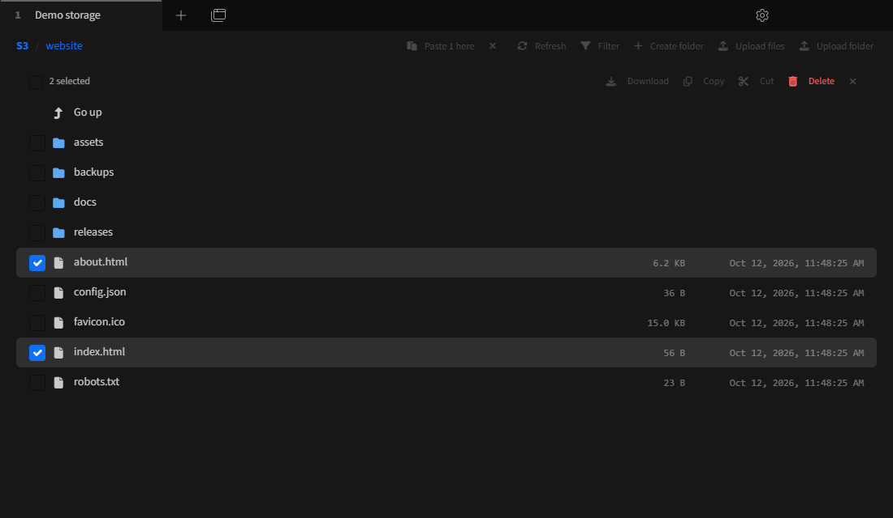
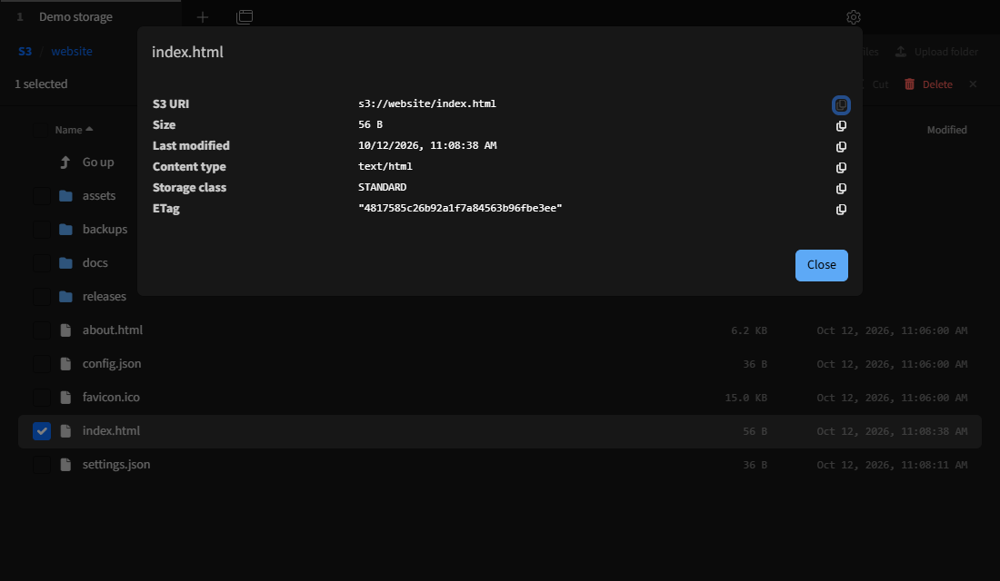
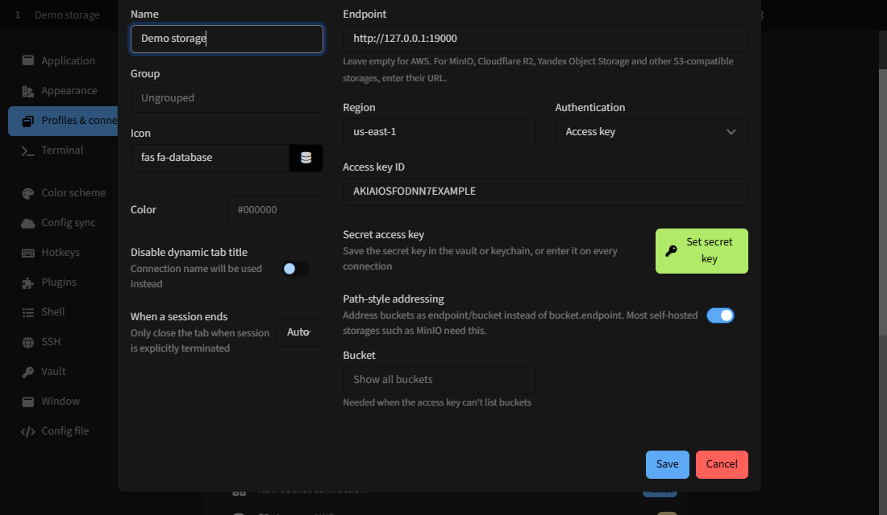

# tabby-s3

S3 storage browser for [Tabby](https://tabby.sh). Works with AWS S3 and S3-compatible storages: MinIO, Cloudflare R2, Yandex Object Storage, Backblaze B2, Wasabi and others.



## Features

- **Browse** buckets, folders and objects, with breadcrumbs, path editing (double-click the path), a filter, sorting by name, size or date, and folders with any number of objects, loaded a thousand at a time
- **Upload** files and folders, also by drag and drop. Content types are set from file extensions, so a bucket that serves a website shows pages and images instead of downloading them. Before overwriting anything, the plugin asks whether to replace or skip
- **Download** files, folders and selections, with progress in Tabby's transfers menu
- **Edit locally**: open an object in its default app; every save is uploaded back while the tab is open
- **Copy, move and rename** objects and folders, within a bucket or between buckets, including objects over 5 GB
- **Select several items** with checkboxes, Ctrl/Cmd+click or Shift+click, to download, copy, move or delete them together
- **Share** an object with a download link valid for an hour, a day or a week, or copy its `s3://` URI
- **Properties**: size, content type, storage class, ETag, version and metadata of objects; size and file count of folders; region of buckets
- **Buckets**: create and delete them
- Open tabs come back at the same location after a restart



## Setting up a profile

Settings → Profiles & connections → New profile → **S3 storage**.



| Field | Value |
| --- | --- |
| Endpoint | Empty for AWS; otherwise the storage URL, e.g. `http://localhost:9000` (MinIO), `https://<account>.r2.cloudflarestorage.com` (R2), `https://storage.yandexcloud.net` (Yandex) |
| Region | The bucket's region. When empty, the one from the AWS CLI configuration, or `us-east-1`. R2 uses `auto`, Yandex `ru-central1` |
| Authentication | See below |
| Path-style addressing | Enable for MinIO and most self-hosted storages |
| Bucket | Optional. Set it when the key can't list buckets; the browser then can't go above it |
| Folder | Optional folder in the bucket to open |

Authentication:

- **Access key**: an access key ID in the profile, and a secret key kept in Tabby's vault when it is enabled, or in the OS keychain otherwise. Leave it unsaved to be asked on every connection. When the storage rejects a saved key, the tab offers to enter it again.
- **AWS CLI profile**: a profile from `~/.aws/config` or `~/.aws/credentials`, including SSO profiles (sign in with `aws sso login` first).
- **Environment and default AWS CLI profile**: `AWS_ACCESS_KEY_ID` and `AWS_SECRET_ACCESS_KEY`, `AWS_PROFILE`, or the default profile, found the way the AWS CLI finds them.

## Tips

- Right-click an item for everything you can do with it. With several items selected, the menu applies to all of them.
- To move items, **Cut** them, open the target folder (in any bucket of the same profile) and press **Paste here**. **Copy** works the same way; copies in the same folder get "(copy)" names.
- Edited files are uploaded back only while their tab is open.

## Installation

Requires Tabby 1.0.224 or newer.

Find **s3** in Settings → Plugins, or download `tabby-s3-<version>.tgz` from the [latest release](https://github.com/zl0i/tabby-s3/releases/latest), close Tabby and run:

```sh
# Windows, PowerShell
npm install --prefix "$env:APPDATA\tabby\plugins" path/to/tabby-s3-<version>.tgz
# Windows, cmd
npm install --prefix "%APPDATA%\tabby\plugins" path/to/tabby-s3-<version>.tgz
# macOS
npm install --prefix ~/Library/Application\ Support/tabby/plugins path/to/tabby-s3-<version>.tgz
# Linux
npm install --prefix ~/.config/tabby/plugins path/to/tabby-s3-<version>.tgz
```

The plugins folder also opens from Settings → Plugins → Open Plugins Directory. A portable Tabby that has a `data` folder next to `Tabby.exe` keeps plugins in `data\plugins` instead. Start Tabby again, and **S3 storage** shows up among the new profile types.

## Development

```sh
npm install
npm run build        # or: npm run watch
npm run lint
TABBY_PLUGINS=$(pwd) tabby --debug
```

Tests of the S3 operations run against a real storage; without `S3_TEST_ENDPOINT`, only the unit tests run:

```sh
docker run -d --rm -p 19000:9000 -e RUSTFS_ACCESS_KEY=testkey -e RUSTFS_SECRET_KEY=testsecret123 rustfs/rustfs:1.0.1
S3_TEST_ENDPOINT=http://127.0.0.1:19000 npm test
```

`src/tabbyCompat.d.ts` declares the parts of Tabby's API that are missing from the outdated `tabby-core` typings on npm.

## Releasing

Bump `version` in `package.json`, then push a tag:

```sh
git tag v0.2.1
git push origin v0.2.1
```

GitHub Actions lints, tests against an S3 server ([RustFS](https://github.com/rustfs/rustfs)), builds the plugin and attaches `tabby-s3-<version>.tgz` to the release. Then run `npm publish` for the Plugin Manager. The AWS SDK is bundled into `dist/index.js`, so the package has no runtime dependencies.
